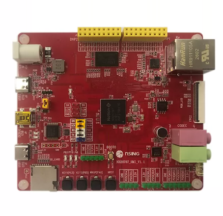
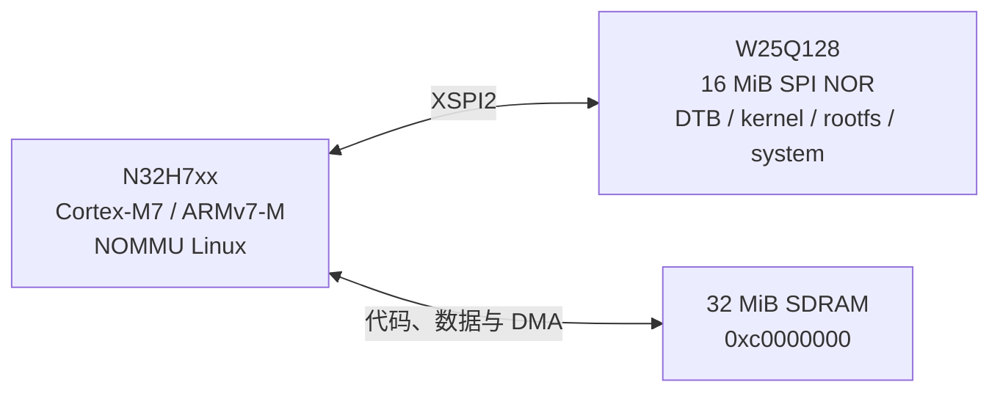
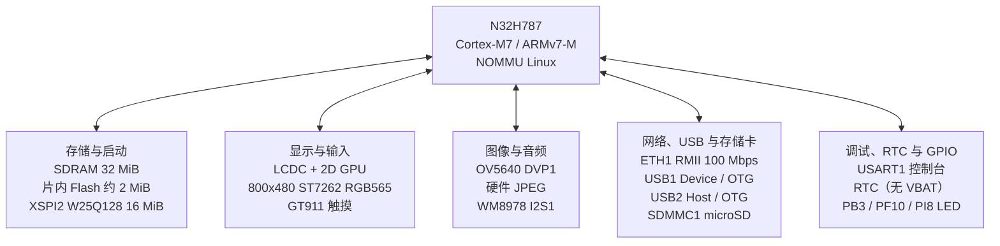
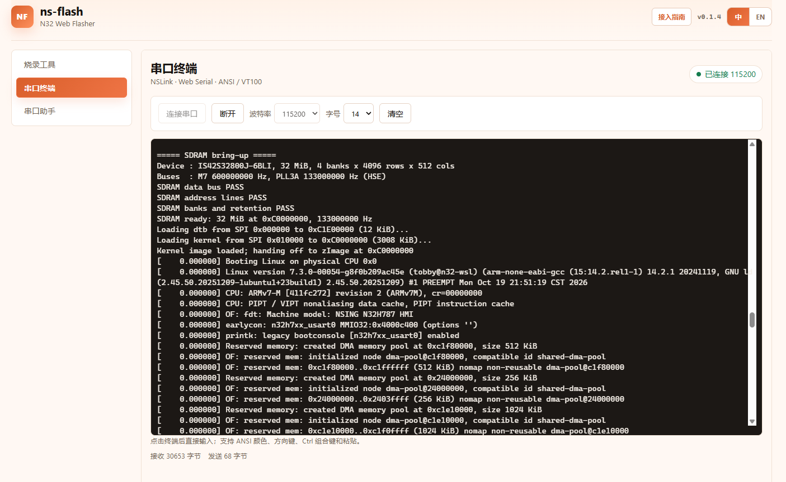

# N32H7xx Linux 实验项目

本项目用于探索和验证 NSING N32H7xx/N32H787 上的 Linux，包含 bootloader、
内核、rootfs 和用户态 SDK。目标板是 ARMv7-M 架构的 NOMMU 系统，内存和进程
模型与常见 Linux 不同，开始开发前请先读[了解 NOMMU Linux](#了解-nommu-linux)。

**这是实验项目**，面向学习、开发与功能验证。功能和接口可能调整，尚未经过完整的
产品级稳定性、可靠性与安全验证；用于实际产品前，需要自行完成相应验证。

## 功能清单

| 类别 | 功能 |
| --- | --- |
| 系统 | Linux 运行环境、进程管理、定时与调度、内核配置定制 |
| 启动与更新 | Bootloader、USB 刷机、探针烧录、网络固件更新 |
| 板级外设 | 串口控制台、标准 LED class、GPIO、引脚配置、I2C、RTC |
| 网络 | 以太网、IPv4 / IPv6、自动获取地址、网络校时、HTTPS 客户端（curl + Mbed TLS） |
| 远程访问 | SSH、SCP、SFTP |
| 存储 | SPI NOR、SD 卡、U 盘、只读根文件系统和可写数据分区 |
| USB | Host / Device 角色、ADB 终端与文件传输、虚拟串口、外设接入 |
| 摄像头 | OV5640 图像采集；人形位置检测、MJPEG 预览与彩色抓图作为可选组件 |
| 音频 | WM8978 录音与播放 |
| 图形显示 | 可选 LVGL 9.6.0（默认自动启用 2D GPU，支持软件回退）；标准 DRM/KMS（libdrm）与 fbdev 后端；2D GPU 填充、批量矩形、混合、复制、多边形与曲线 |
| 用户态 | BusyBox 命令、Shell 脚本、文本处理、网络与进程管理工具 |
| 应用开发 | C / C++ 交叉工具链、运行库及应用示例 |

## 硬件平台

本项目当前发布的板级配置对应 **N32H787_HMI_V1.1**，设备树为
`kernel/arch/arm/boot/dts/nsing/n32h787-hmi.dts`。



### 硬件总览

| 部件 | 当前配置 |
| --- | --- |
| SoC | NSING N32H787XIB7_BGA240，Cortex-M7，ARMv7-M，运行 NOMMU Linux |
| 主内存 | 32 MiB SDRAM，物理地址 `0xc0000000` |
| 片内 Flash | 约 2 MiB，保存 bootloader |
| 外部 SPI NOR | XSPI2 上的 W25Q128，16 MiB，保存 DTB、kernel、rootfs 和 system |
| 启动控制台 | USART1，`PA9=TX`、`PA10=RX`，`115200 8N1` |

### 理论最小启动核心

对当前 kernel 和 rootfs，理论最小启动核心是：N32H7xx，运行 kernel 的 32 MiB
SDRAM，以及保存 DTB、kernel 和 rootfs 的 W25Q128 SPI NOR。sdmmc、LCD、触摸、
摄像头、音频、以太网、USB 和 GPIO 外设都不在启动必经路径上。



### N32H787_HMI_V1.1 外设

| 类别 | 板载器件与接口 | 发布镜像支持 |
| --- | --- | --- |
| 显示 | 4.3 英寸 800x480 RGB565 屏，NTW430T40X005A / ST7262，25 MHz；LCDC 和 2D GPU | 默认启用；`LCD=0` 可关闭并交回图形预留内存 |
| 触摸 | GT911，I2C1（`PD4/PD5`），中断 `PD11`，复位 `PD6`，坐标翻转后对应 800x480 屏 | 默认启用 |
| 摄像头 | OV5640，DVP1 8-bit，I2C4 地址 `0x3c`，模块自带 24 MHz 时钟，复位 `PC13` | 可选；使用 `make CAMERA=1` 构建 |
| 音频 | WM8978，I2C4 地址 `0x1a`，I2S1：MCLK `PA3`、BCLK `PA5`、WS `PG10`、SDI `PG9`、SDO `PD7` | 默认启用，支持录音和播放 |
| 图像处理 | 片内硬件 JPEG 编解码器，设备节点 `/dev/jpeg` | 默认启用，独立于摄像头 |
| 以太网 | ETH1 RMII，NET1001A / JL1111B 兼容 PHY，MDIO 地址 1，复位 `PB1`，支持 100 Mbps 全双工 | 默认启用 |
| USB1 | Device / OTG，`PA11/PA12`；bootloader 用作 USB MSC，Linux 用作 ADB | 默认启用 |
| USB2 | Host / OTG，`PB14/PB15`，VBUS 控制 `PB4`；可接 U 盘和 CMSIS-DAP | 默认启用 |
| SD 卡 | SDMMC1 4-bit，CLK `PC12`、CMD `PD2`、D0-D3 `PC8-PC11` | 默认启用 |
| RTC | SoC 内置 RTC；板上没有 VBAT 电池，断电后时间丢失，可由 NTP 校准 | 默认启用 |
| LED 与 GPIO | PB3/PF10/PI8 三色 LED 通过 `/sys/class/leds` 控制；GPIO 可用于其他外设和状态指示 | 默认启用 |
| 调试 | 外部 NSLink / CMSIS-DAP；USART1 串口控制台 | 开发接口，不属于板载外设 |

板级拓扑如下：



默认构建启用 LCD/GPU，不包含 OV5640 摄像头驱动组合。需要摄像头时必须使用
`make CAMERA=1`；不需要显示时可使用 `make LCD=0`。SPI NOR 中的具体分区见
[存储分区](#存储分区)。这两个选项只在构建时合并对应的设备树 overlay，
最终产物始终是 `out/kernel/n32h787-hmi.dtb`。

## 快速体验

烧录后可在串口终端查看启动过程：



不编译也能直接烧录 `bin/` 下的现成镜像。连接 NSLink 探针后打开：

**[打开 Web 烧录页面](https://update.nsingtech.com/ns-flash/index.html?target=n32h78x&firmware=https%3A%2F%2Fraw.githubusercontent.com%2FNSING-Community%2Fn32h7xx_linux%2Fmain%2Fbin%2Fbootloader.bin&spi-firmware=https%3A%2F%2Fraw.githubusercontent.com%2FNSING-Community%2Fn32h7xx_linux%2Fmain%2Fbin%2Fspi-nor-boot.img&algorithm=n32h787-xspi2&lang=zh)**

该页面和预填镜像针对 **N32H787_HMI_V1.1**。需要 Chrome 或 Edge，按页面提示
烧录即可；`system` 分区不受影响。

## 快速开始

按顺序完成以下步骤。主机命令都在仓库根目录的 WSL / Linux 终端执行。

### 环境准备

WSL2、编译依赖和 USB 工具的安装见[环境搭建](doc/setup.md)。

### 获取源码

`kernel/` 是 Git 子模块，其余目录都在本仓库。首次克隆使用：

```sh
git clone --recurse-submodules https://github.com/NSING-Community/n32h7xx_linux.git \
    ~/research/n32h7xx_linux
cd ~/research/n32h7xx_linux
```

`--recurse-submodules` 会一并拉取 `kernel/`，不需要再单独初始化。

已经克隆但 `kernel/` 是空目录（漏了上面的参数，或从源码压缩包解出）时补一次：

```sh
git submodule update --init
```

更新已有工作区时，先拉取主工程，再让子模块跟上主工程记录的提交：

```sh
git pull
git submodule update --init --recursive
```

默认按主工程记录的 kernel 提交构建，子模块为浅克隆（完整内核历史约 10 GiB）。
确实需要更多历史，或要主动跟 `n32h7xx` 分支最新提交时：

```sh
git -C kernel fetch --deepen=200       # 按需多次执行；--unshallow 拉取完整历史
git submodule update --remote kernel   # 主动升级；日常构建不建议使用
```

kernel 仓库：[NSING-Community/linux](https://github.com/NSING-Community/linux.git)

### 构建

```sh
make              # 全部：bootloader + kernel + rootfs + SPI NOR 镜像
make bootloader   # CM7 bootloader
make kernel       # zImage + <BOARD>.dtb 和可加载模块
make rootfs       # 打包 SquashFS rootfs
make menuconfig   # 修改内核配置
make CAMERA=1     # 带 OV5640 摄像头支持的完整镜像（默认不含）
make LCD=0        # 不启用 LCD/GPU，交回 3 MiB 图形内存（默认启用）
make help         # 查看全部目标和可覆盖变量
```

内核工作配置保存在 `out/kernel/build/.config`，修改和保留规则见
[内核配置](doc/kernel-config.md)。

### 烧录与登录

首次使用的完整流程（接线、进入 MSC、USB 透传、读回校验、ADB / 串口 / SSH
登录）见[快速上手](doc/quickstart.md)。最短路径：

```sh
make
sudo tools/h787ctl msc-write out/dist/spi-nor-boot.img
```

让板子进入 MSC，并把 `19f5:5780` attach 到 WSL 的步骤见
[USB MSC 烧写](doc/tools.md#usb-msc-烧写)。

不进入 MSC、直接用 NSLink 探针烧写片内 bootloader 或外部 SPI NOR 时，
见[ns-flash 命令行烧录](tools/ns-flash/README.md)。

## 构建产物与存储布局

### 产物

构建产物全部位于 `out/`：

```text
out/dist/spi-nor-16M.img        # 整片 SPI NOR 镜像 + .sha256
out/dist/spi-nor-boot.img       # dtb + kernel + rootfs，不覆盖 system
out/dist/bootloader.bin         # CM7 bootloader，写入片内 flash
out/kernel/                     # zImage、<BOARD>.dtb、System.map、config、模块
out/rootfs/rootfs.squashfs      # 只读 rootfs
out/bootloader/CM7/             # bootloader 调试产物
out/recover-<时间戳>/           # 烧写 bootloader 时的备份
```

### 存储分区

设备上有两块存储器：片内 flash（约 2 MiB）只放 bootloader，使用 CMSIS-DAP
探针烧写；外部 SPI NOR（默认 16 MiB）放 dtb、kernel、rootfs 和 system。

外部 SPI NOR 的分区布局固定如下，所有工具都以这张表为准：

| 分区 | 偏移 | 大小 | 挂载点 | 运行时写入 |
| --- | --- | --- | --- | --- |
| `dtb` | `0x000000` | 64 KiB | 不挂载 | 可以，重启生效 |
| `kernel` | `0x010000` | 4 MiB | 不挂载 | 可以，重启生效 |
| `rootfs` | `0x410000` | 3 MiB | `/`（SquashFS，只读） | 整分区更新，重启生效 |
| `system` | `0x710000` | `FLASH_SIZE - 0x710000`（至少 8 MiB） | `/system`（JFFS2，读写） | 可以 |

`make` 默认生成 16 MiB 的整片镜像；其他容量使用 `make FLASH_SIZE=32M` 等，
`system` 自动占用剩余空间。`spi-nor-boot.img` 始终只覆盖到 `0x710000`，与
FLASH 容量无关。

内核命令行：

```text
earlycon console=ttyS0,115200 root=/dev/mtdblock2 rootfstype=squashfs ro rootwait
```

### 更新方式

不同内容的更新方式如下，具体命令见对应文档：

| 更新内容 | 方式 | 文档 |
| --- | --- | --- |
| 应用程序、库 | `scp` / `adb push` 到 `/system` | [SDK：部署到设备](doc/sdk.md#部署到设备) |
| dtb / kernel / rootfs | SSH 网络 OTA | [网络 OTA](doc/ota-update.md) |
| dtb + kernel + rootfs | USB MSC 写入 `spi-nor-boot.img` | [主机工具与烧写](doc/tools.md#usb-msc-烧写) |
| bootloader | CMSIS-DAP 探针烧写片内 flash | [烧写 bootloader](doc/tools.md#烧写-bootloader) |

## 文档导航

| 文档 | 内容 |
| --- | --- |
| [环境搭建](doc/setup.md) | 开发环境和工具准备 |
| [快速上手](doc/quickstart.md) | 编译、刷机、登录和首次运行 |
| [主机工具与烧写](doc/tools.md) | USB 刷机、探针烧录与串口连接 |
| [网络 OTA](doc/ota-update.md) | 通过网络更新固件 |
| [内核配置](doc/kernel-config.md) | 定制与保存内核配置 |
| [SDK 与应用开发](doc/sdk.md) | 编译、部署和运行应用 |
| [USB](doc/usb.md) | ADB、虚拟串口、存储与角色切换 |
| [摄像头](doc/camera.md) | 图像与视频采集 |
| [LCD 显示与 GPU](doc/display.md) | 实验性显示接口、构建与验证步骤 |
| [音频](doc/audio.md) | 录音、播放与音量设置 |

## 了解 NOMMU Linux

NOMMU Linux 是运行在**没有内存管理单元（MMU）**的处理器上的 Linux。
它仍提供进程、线程、文件系统和网络接口，但无法像普通 Linux 那样，给每个进程
建立独立的虚拟地址空间，或把分散的物理内存拼成连续的地址供程序使用。

| 方面 | 优势与限制 |
| --- | --- |
| 软件生态 | 可以复用 Linux 驱动、网络协议、Shell 和许多 C/C++ 开源软件；但需要面向目标重新编译，依赖 `fork()`、复杂内存映射或大型运行时的软件可能需要移植，不能直接照搬普通发行版的软件包。 |
| 硬件与资源 | 让没有 MMU 的微控制器也能使用 Linux 的开发接口和工具；Linux 自身仍有资源开销，并不天然比裸机或 RTOS 更省内存、更实时。 |
| 内存分配 | 大块申请往往需要连续物理内存。反复申请、释放后，空闲空间可能被切成小块，出现“总空闲内存不少，但大块申请失败”；程序装载和线程栈也会受影响。 |
| 故障隔离 | 缺少普通 Linux 基于 MMU 的进程内存隔离，越界访问可能影响其他程序甚至内核，不能把多进程等同于可靠的安全隔离。 |

**适合的场景**：功能相对固定、内存需求可控的联网控制器、数据采集终端、
协议转换、轻量网关，以及嵌入式 Linux 学习和驱动实验。

**不适合直接照搬的负载**：桌面浏览器、大型数据库、本地大模型推理、频繁申请
大块内存的任务，以及依赖强进程隔离的多租户服务。能编译通过，不代表能在板上
启动并长期稳定运行。

开发时应优先使用流式处理、小块缓冲和可复用的内存，减少运行中反复进行大块申请，
并处理分配失败。启动时能成功的大块分配，运行一段时间后也可能因碎片而失败。
映射和进程接口的具体限制见 [Linux 官方 NOMMU 文档](https://docs.kernel.org/admin-guide/mm/nommu-mmap.html)。

## 可选组件

可选组件随 SDK 提供，单独安装，不参与默认构建，也不进入固件镜像。

| 组件 | 用途 |
| --- | --- |
| [espeak-ng](sdk/optional/espeak-ng/README.md) | 英文、中文语音合成与播放 |
| [ns-flash](sdk/optional/ns-flash/README.md) | 通过外接 NSLink 探针识别、烧写目标芯片 |
| [WeniClaw](sdk/optional/weniclaw/README.md) | 轻量 AI 助手（命令行与微信） |
| [human-detect](sdk/optional/human-detect/README.md) | 人形位置检测、灰度 MJPEG 预览和彩色抓图 |
| [LVGL 图形库](sdk/optional-src/lvgl/README.md) | 标准 DRM/KMS 与 fbdev 后端、CPU 绘制的显示示例 |

安装、使用和运行条件见各组件说明；espeak-ng、human-detect 等可选组件源码及构建说明见
[可选组件源码](sdk/optional-src/README.md)。

## Licensing

根目录 [LICENSE](LICENSE) 为 **BSD-3-Clause**，适用于采用该许可的本项目自有代码。
Linux 内核遵循自身 **GPL-2.0-only** 及逐文件声明；第三方组件保留各自的版权、
许可证和 NOTICE，不受顶层 BSD 许可证覆盖。可选 ns-flash 为公司自有闭源程序。

分发 SDK 或固件时，须按各组件许可证提供声明和必要的完整对应源码，包括实际修改、
配置及构建脚本，并满足适用的库替换、重链接等要求。许可证和源码作为独立发行附件
提供，不增加固件镜像体积。

组件、版本、来源与声明见 [THIRD_PARTY_NOTICES.md](THIRD_PARTY_NOTICES.md)，
发行要求和未确认项见[许可证说明](licenses/README.md)。
