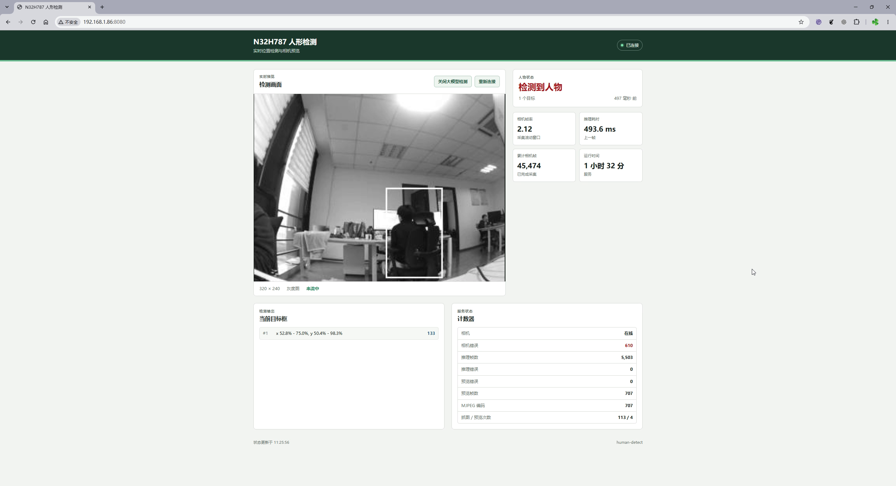

# 人形检测服务

`human-detect` 是可选的摄像头应用，持续做 320x240 灰度人形位置检测，并提供
彩色抓图、灰度 MJPEG 预览和浏览器仪表盘。`human-detect-ui` 是带触摸控制的
板端 LVGL 监视器。两者不属于固件镜像；安装后位于可写的 `/system/bin`，升级
kernel 或 rootfs 不会丢失。

使用前先构建 `CAMERA=1` 的固件，让内核提供 OV5640、DVP 和 `/dev/video0`。
检测服务会独占摄像头，运行时不要再启动 `v4l2-capture`。

浏览器仪表盘的实际运行画面：



## 安装

SSH：

```sh
BOARD=<板子IP> USE=ssh sh sdk/optional/human-detect/install.sh
```

ADB：

```sh
sh sdk/optional/human-detect/install.sh
```

安装脚本会停止旧实例并替换 `/system/bin/human-detect` 和
`/system/bin/human-detect-ui`。默认安装后启动检测服务，板端 UI 在下次开机时
自启；需要安装后立即打开界面时使用：

```sh
START_UI=1 BOARD=<板子IP> USE=ssh sh sdk/optional/human-detect/install.sh
```

rootfs 的 `/system/bin/init.sh` 会在开机时先启动 UI、再启动检测服务。这个顺序
不能颠倒：no-MMU 环境下列表程序需要大块连续内存，检测服务先分配模型和相机
缓冲后，UI 可能在加载阶段失败。

LCDC 默认保持 headless，启动后不扫描面板。`human-detect-ui` 创建 LVGL 显示前
会自动 unblank，退出时关闭扫描；进程被强制终止时，LCDC 驱动也会在最后一个
DRM 客户端关闭后停止扫描。因此未启动 UI 时屏幕保持黑色是正常状态，不代表
显示驱动故障。纯相机或后台检测场景应保持 headless，避免无意义的 SDRAM 带宽
占用。需要恢复旧的启动即扫描行为时，可在内核命令行使用
`n32h7xx_lcdc.headless=0`。

## 使用

浏览器打开：

```text
http://<板子IP>:8080/
```

首页显示实时灰度画面、检测框、人物状态、相机帧率、推理耗时、累计相机帧数、
运行时间和错误计数。端侧人员检测模型默认关闭；网页上的“打开端侧人员检测模型”只控制后续
推理和人员事件，相机帧率、预览与彩色抓图始终工作。MJPEG 同时只允许一个预览客户端。

没有 MJPEG 客户端时，服务不会执行 JPEG 预览编码；只有连接
`/preview.mjpg` 后才按请求帧率编码。板端 UI 使用原始 Gray8 流，不经过 JPEG。
`/status` 的 `jpeg_preview_encodes` 可用来核对编码次数。

先启动板端 UI：

```sh
setsid /system/bin/human-detect-ui -s /run/human-detect.sock \
    -i /dev/input/event0 >>/tmp/human-detect-ui.log 2>&1 </dev/null &
pidof human-detect-ui
```

UI 启动时检测服务可以尚未运行，界面会显示 `SERVICE OFFLINE` 并自动重连。
然后启动检测服务：

```sh
setsid /system/bin/human-detect --socket /run/human-detect.sock \
    --http-port 8080 >>/tmp/human-detect.log 2>&1 </dev/null &
pidof human-detect
```

停止：

```sh
killall human-detect
pidof human-detect || echo stopped
```

日志位于 `/tmp/human-detect.log`。修改 `--http-port` 可以更换 HTTP 端口。

## 板端触摸界面

屏幕连接并启用 GT911 后启动。若检测服务已经运行，先执行
`killall human-detect`，再按上一节的顺序启动 UI：

```sh
setsid /system/bin/human-detect-ui -s /run/human-detect.sock \
    -i /dev/input/event0 >>/tmp/human-detect-ui.log 2>&1 </dev/null &
pidof human-detect-ui
```

界面显示未加工的 320x240 灰度检测画面、检测框、人物状态、相机帧率、预处理和
推理耗时、累计相机帧数、帧年龄及错误计数。触摸 `PAUSE` 会冻结画面并断开本地预览
流，触摸 `RESUME` 后重新连接；`BOXES ON/OFF` 控制检测框显示。默认请求 15 FPS，
可用 `-f 3..15` 按需降低刷新率。`INFERENCE OFF/ON` 是首次上电的初始状态，
触摸后可直接启停大模型推理；关闭推理时本地画面和相机帧率继续刷新，但不再显示
检测框或发送人员通知。

画面通过 `/run/human-detect.sock` 直接传输 L8 灰度帧，不做 JPEG 编解码；板端
UI 收到完整帧后一次性转换为 RGB565 画布，交给 LCDC/GPU 显示。关闭 UI 后，
检测服务会立即释放预览缓冲，继续独立运行检测、抓图和事件通知。

检测到人物变化时，服务需要短暂切换到彩色 JPEG 拍事件照片。这期间 UI 会显示
`SERVICE CLOSED`，保留最后一帧，并在抓图结束后自动恢复；短暂停顿不代表 UI
进程退出。

无输入设备时可以临时关闭触摸输入；`-t 30` 用于运行 30 秒后自动退出：

```sh
/system/bin/human-detect-ui -i none -t 30
```

停止界面：

```sh
killall human-detect-ui
pidof human-detect-ui || echo stopped
```

如果 `ps` 中状态是 `T`，表示进程被作业控制暂停；普通 `killall` 发送的
`SIGTERM` 只会在进程恢复后生效。此时使用：

```sh
killall -9 human-detect-ui
```

## 人形出现通知

检测到“无人到有人”的变化时，服务会向
`/run/weniclaw/control.sock` 提交 `human.detected` 任务。已经运行的
`wechat run` 会先拍摄一张 1024x768 彩色事件照片，再通过已配对的微信发送
检测结果和照片，并把同一事件写入 `/system/weniclaw/workspace/latest-event.json`。
之后追问这次事件时，WeniClaw 会把上下文带入模型，并按需读取
`/system/weniclaw/workspace/latest-human.jpg`。`human-detect` 不会启动第二个
WeniClaw。

本地和服务端都按 5 分钟窗口抑制重复通知。WeniClaw 未启动或接口暂时不可用时，
检测服务每 30 秒重试一次；重试沿用该次状态跃迁的同一个幂等键，所以服务恢复
后不会把同一事件重复排队。检测、仪表盘和预览不受影响。使用其他路径：

```sh
setsid /system/bin/human-detect --socket /run/human-detect.sock \
    --task-socket /run/weniclaw/control.sock --http-port 8080 \
    >>/tmp/human-detect.log 2>&1 </dev/null &
```

需要同时安装并配置
[WeniClaw](../weniclaw/README.md)。只安装 `human-detect` 时不会产生微信消息。

## 接口

| 接口 | 内容 |
| --- | --- |
| `/` | HTML 仪表盘 |
| `/status` | 相机、推理、检测框和计数器 JSON |
| `POST /inference?enabled=0` / `...=1` | 运行时关闭或开启大模型推理 |
| `/preview.mjpg?fps=15` | 320x240 灰度 MJPEG，连接到客户端断开为止 |
| `/snapshot.jpg?size=1024x768` | 彩色 JPEG；抓图时预览会暂时不可用 |

板端 `/preview.gray8` 流只接受来自 `/run/human-detect.sock` 的本机连接，不通过
TCP HTTP 对外提供。

抓图支持 `160x120`、`176x144`、`320x240`、`640x480`、`720x480`、`720x576`、
`1024x768`、`1280x720`、`1920x1080` 和 `2592x1944`。

## 许可证

本程序和自训练模型使用 BSD-3-Clause。二进制静态包含 TensorFlow Lite Micro、
CMSIS-NN、FlatBuffers 和 gemmlowp，均按 Apache-2.0 使用；完整声明见
`LICENSE`、`THIRD_PARTY_NOTICES.md` 和 `licenses/`。

## 卸载

```sh
killall human-detect-ui 2>/dev/null || true
killall human-detect
rm /system/bin/human-detect-ui
rm /system/bin/human-detect
```
